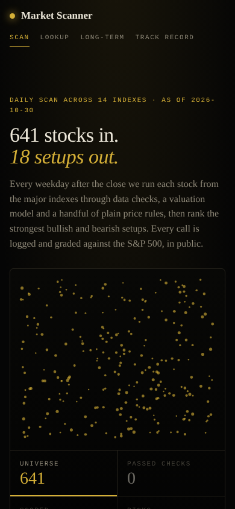

# Market Scanner

A daily scan of global stock indexes that finds stocks that look mispriced, ranks the strongest bullish and bearish price setups, explains each one in plain words, and then grades its own calls in public. One engine, one static website.

**Not investment advice.** Scores are mechanical rules on valuation, price and volume. They are not forecasts, and nothing here is a recommendation to trade. Data comes from Yahoo Finance and can be delayed or wrong.

## What it does
- **Universe:** the S&P 500, Nasdaq 100 and Dow, the Russell 2000 (its real constituents, about 1,900 US stocks from the iShares IWM holdings file, not just the index level), plus 8 to 15 of the largest names from each of the other major indexes (see `scanner/universe.py`; this line is the one to update when the universe changes).
- **Daily pass:** every weekday after the close each stock in the universe goes through data checks, a valuation model and a handful of plain price rules, then the strongest bullish and bearish setups are ranked. Every call is logged and graded against the S&P 500, in public (same wording as the site's opening line).
- **Three views of every stock:**
  - **Mispricing** (-100 to +100): valuation vs sector peers (P/E, EV/EBITDA, P/B, FCF yield), quality, the analyst consensus gap and stretch vs the recent move, with a plain "why". With an Anthropic key, Claude writes a thesis with catalysts and risks from the numbers and headlines.
  - **Short-term** (0 to 100): 20-day average, 5 and 10 day momentum, RSI, volume. Three plain reasons per name.
  - **Swing** (0 to 100): 50 and 200-day averages, their slope, 3-month strength vs the S&P 500, distance from the 52-week high.
- **Labels:** every call is **Bullish**, **Bearish** or **Neutral**. (Older logs used BUY/SELL/WATCH; those still load and map to the new names.)
- **Funnel:** universe, stocks with data, passed data checks (history, freshness, liquidity), scored, picks.
- **Track record:** every Bullish or Bearish call is logged and graded vs SPY.

## Russell 2000 coverage
- **Constituents:** each scan downloads the iShares IWM holdings CSV (equities only; cash, futures, money market and non-US lines dropped; `BRK.B` becomes `BRK-B`) and caches it to `data/universe/russell2000.csv` with the file's as-of date. If the download fails or the file looks wrong (under 1,000 equities, or not a CSV), the committed cache is used and the old file is never overwritten.
- **First run:** until `data/universe/russell2000.csv` exists, the first successful nightly fetch creates and commits the cache. Until then the Russell 2000 is skipped with a warning, recorded as a dropped basket in the scan (`dropped_baskets`), and the site shows a short note on Home and How it works. An HTML response (not a CSV) is logged as such and treated as a failed pull.
- **Overlaps:** a stock in several indexes is scanned once and keeps every index tag. The funnel shows each index's counts (a stock in two indexes counts in both).
- **Filters unchanged:** 252 bars of history, fresh within 5 days, 20-day average dollar volume of at least $1M, sane values. Illiquid small caps drop out and show in the "dropped" counts. Fundamentals are fetched only for names that pass, to keep the run short.
- **Run time (estimate, unmeasured on live Yahoo):** about 2,600 tickers in batches of 250 (threaded, 60 s timeout per call, one retry, 25 minute total budget), then about 2,300 fundamentals calls with 16 workers. Expect 10 to 20 minutes nightly; the workflow stops at 45. A synthetic 2,100-stock offline scan runs in under 30 seconds, so the engine itself is not the bottleneck; Yahoo is.
- **Site data:** about 1KB per stock in `site/data/latest.json`, so roughly 2.5MB with the Russell 2000 (limit in tests is 3MB; the host serves it gzipped).

## How calls are graded
- **Entry is the next trading day's close** after the signal date, never the signal's own close. SPY uses the same entry day.
- **Windows are 5, 20 and 60 trading days** counted from that entry close.
- A Bullish call wins by beating SPY over the window, a Bearish call by lagging it. Neutral is never graded.
- **Still noise:** until the log covers 60 trading days (the longest grading window, per the approved backlog item; it was 21 before) the whole record is labeled "still noise", and the Track record page shows progress as "day N of 60".
- **Hit rate with n and a range:** each lens card on the Track record page shows the hit rate versus SPY, n (calls graded in that window) and a 95 percent Wilson interval (`scanner/record.py`). Calls made on the same day share market conditions, so the true range is wider.
- **Append-only log:** every row of `data/picks.csv` ends with a `chain` value (sha256 of the previous chain value plus the row's raw fields, `scanner/calllog.py`). `python scripts/check_call_log.py` fails if any past row is edited, removed or reordered; with `--base origin/main --strict` (CI) it also fails if any published row differs from the published version or is missing, even when the chain was recomputed. The daily scan runs it without `--strict` against its own last commit (`--base HEAD`), so only the newest date's rows may be rewritten there, by the same run. Later runs never replace an earlier run's rows (the `run_id` rule); only the same run may rewrite its own rows for the newest date. CI (`.github/workflows/ci.yml`) runs the check and the tests on every pull request and push to main, and the daily scan runs it before committing.
- **Weekly snapshots:** `scripts/snapshot_record.py` writes `data/snapshots/<year>-W<week>.json` once per ISO week (settled row count, chain head, the per-lens record). The check fails if a snapshot's head no longer matches the log.
- Rows logged before this rule (blank `entry_rule` in `data/picks.csv`) keep their original same-day entry, so history is not rewritten.

## What it looks like


Live site: https://abvarisano-droid.github.io/market-scanner/ (after Pages is enabled)

## Run it
```bash
pip install -r requirements.txt pytest
python run_scan.py                  # full scan, writes reports/<date>.md and data/latest_scan.json
python run_scan.py --max 150        # quick test run
python scripts/export_site.py       # data/latest_scan.json -> site/data/latest.json and track.json
python scripts/export_site.py --sample   # regenerate the labeled sample data (synthetic, no network)
streamlit run app.py                # optional analyst dashboard
python -m pytest -q                 # offline tests, no network
```
`ANTHROPIC_API_KEY` is optional. In GitHub Actions it is read from the repo secret `MARKET_TEAM_ANTHROPIC_API_KEY` (Settings, Secrets and variables, Actions) and only the scan step sees it. No other secrets are needed.

## The website
`site/` is plain static files (`index.html`, `style.css`, `app.js`, `data/*.json`) with no build step. Tabs: Mispricing, Short-term, Swing, plus a ticker lookup, the Long-term tab and the public track record (in the main nav, with its sample size and "still noise" state).

- **Vercel:** import the repo, set the output directory to `site`, no build command.
- **GitHub Pages:** publish the `site/` folder (Pages action, or a `gh-pages` branch from it).
- Preview locally: `python -m http.server -d site 8000`.

The committed `site/data/` comes from the latest real daily scan. Only `python scripts/export_site.py --sample` writes synthetic data, and that output carries a "Sample data" banner.

### Stock page chart
Every called ticker (the ones in `data/picks.csv`) gets a chart on its stock page (`#/stock/<TICKER>`) and in Lookup: three years of candles (weekly, then daily for the last six months), with toggles for Candlesticks or Line, Volume, 50-day SMA, 200-day SMA, Bollinger Bands (20, 2), RSI (14), MACD (12, 26, 9), 52-week range reference lines, the volatility cone (plus and minus one sigma) and Next earnings when Yahoo publishes a date. Toggle state lives in the URL hash (`?on=...&view=line`), not in storage. A Fundamentals card (forward and trailing P/E, EV/EBITDA, analyst consensus gap, sector, market cap) sits under it.

- Data: the nightly scan fetches 3 years of daily OHLCV for the called tickers only (one extra batched download of about 70 names plus one calendar lookup each, about 20 seconds) and writes `data/charts.json` (`scanner/charts.py`). The export writes one file per ticker to `site/data/charts/<TICKER>.json` (about 20KB, 7KB gzipped). Refresh by hand with `python scripts/build_charts.py` then `python scripts/export_site.py`.
- Volatility cone: an illustration from the stock's own past volatility, not a forecast. It is centered on no change (zero drift) so it never reads as an expected return or price level. The +1σ and -1σ edges are one standard deviation of yearly moves (daily log return standard deviation times the square root of 252). Paths are drawn as close times exp(plus or minus sigma times the square root of t). `python scripts/build_charts.py --refan` recomputes it offline from the stored sigma.
- Indicators are computed in the browser from the daily closes (`site/indicators.js`), checked against a pandas reference in `tests/test_charts.py`.
- `docs/stock-chart-hero.png` is a 1600x900 capture of a stock page for the personal site.

## Automation
`.github/workflows/daily-scan.yml` runs every weekday after the US close: scan, export site data, run tests, then commit `reports/`, `data/picks.csv`, `data/latest_scan.json`, `data/charts.json` and `site/data/` (contents: write, no force push). `.github/workflows/pages.yml` redeploys `site/` to GitHub Pages on each push that touches `site/` and after each successful Daily scan or weekly SEC refresh.

## Scan watchdog
`.github/workflows/scan-watchdog.yml` runs at 13:07 UTC Monday to Saturday (and on demand). `scanner/watchdog.py` reads the repo's own git log for "Daily scan YYYY-MM-DD" commits and flags any US trading weekday in the last 10 days with no scan by 12:00 UTC the next calendar day (weekends and US market holidays are skipped; days before the first scan are ignored). It writes `site/data/watchdog.json` as `{checked_at, missed, status, market_date, last_scan, catch_up}`: the site footer shows "Scan missed on DATE" when `missed` is not empty, `status` is `ok` or `missed`, `market_date` is the newest US session that has closed and `last_scan` the newest scan commit. When that session has no scan, `catch_up` is true and the job asks GitHub to run the daily scan again (`gh workflow run daily-scan.yml --ref main -f force=false`, repo token only). A missed day also fails the job so GitHub emails the owner. No secret and no network beyond the checkout and that one request.
Follow-up (outside this repo): the Brain reads `site/data/watchdog.json` and raises the flag on its status board.

## Late starts, re-runs and catch-up
GitHub starts scheduled jobs late on busy days (the Friday 2026-10-30 scan started at 00:58 UTC Saturday, three and a half hours late). The pipeline does not care when it runs:
- **As-of is the market date.** The scan's date is SPY's last bar, capped at the newest New York session whose 16:00 close has passed (`watchdog.market_date`, daylight saving handled). Every price series is cut at that date before scoring, so an Asian market's partial next-day bar (already there after midnight UTC) or a partial bar during US trading hours is never used. Before this, the date was the newest bar across all markets, so a late Monday scan could be labelled Tuesday.
- **Commit titles use that date**, not the run date, so the watchdog and the gate below see the right day.
- **Idempotent.** If another run already logged calls for the same as-of date, nothing is added to `data/picks.csv` (before, a same-day re-run could append the calls the first run did not make).
- **Backup and catch-up.** The daily scan has a second cron (03:47 UTC Tuesday to Saturday) and a `gate` job: scheduled starts and the watchdog's catch-up request run only when the newest closed session has no scan commit (`python -m scanner.watchdog --need-scan`). A manual run from the Actions tab is forced by default.
- **Honest limit:** a catch-up the next morning still scores prices only through the as-of close, but headlines and Yahoo fundamentals (analyst targets, P/E) are fetched at run time.

## AI thesis cost
With `MARKET_TEAM_ANTHROPIC_API_KEY` set, each mispricing pick (12 high plus 6 low, so 18 a night) gets one short Claude call (`scanner/news_ai.py`): `claude-sonnet-5-5`, effort `low`, `max_tokens` 2000, a JSON schema for the reply, and the server-side refusal fallback. Every run appends its token counts and estimated cost to `data/ai_usage.json` (calls, ok, skipped, errors by kind, tokens, `cost_usd`; never any key value). An auth, permission or model-not-found error stops further calls for that run.
- **Expected cost (estimate, not yet measured on a live run):** about 600 to 900 input tokens and 200 to 400 output tokens per call, so about $0.004 to $0.006 a call, $0.07 to $0.11 a run and $1.50 to $2.50 a month at 22 runs. Prompt caching does not help here: the fixed instructions are about 200 tokens, under the 512 token minimum.
- **Proposed cap (not enabled):** set the repo variable or env `AI_RUN_COST_CAP_USD=0.50` to stop AI calls in a run once its estimated cost reaches $0.50 (the rules model writes the rest). That is about 5 times the expected run cost and $11 a month at worst, well inside a $140 monthly Claude budget shared across products. Nothing sets it today.

## Layout
`scanner/` engine: `data.py` (yfinance), `universe.py`, `valuation.py` (mispricing), `technical.py` (short-term and swing rules), `news_ai.py`, `tracker.py` (ledger and grading), `labels.py`, `charts.py` (stock page candles and volatility cone), `pipeline.py`. `scripts/export_site.py` feeds `site/`.

## Long-term tab (SEC 10-K)
`site/data/longterm.json` holds, for the S&P 500, 10-year revenue CAGR, operating margin and its 5-year change, FCF margin, an ROIC proxy, 2-year share count change, debt to EBITDA, and FCF yield and EV/EBITDA from the last scan price. Every figure links to the SEC filing folder it came from. Six mechanical yes/no checks give a count; no buy or sell language, "Not investment advice" on the tab. Logic is in `scanner/longterm.py` (10-K facts only, tag fallbacks, latest filing wins per period).
```bash
SEC_USER_AGENT="<name and contact email>" python scripts/fetch_sec.py   # cache raw JSON in data/cache/sec (git-ignored), max 8 req/s
python scripts/build_longterm.py                                         # writes site/data/longterm.json
```
Names with no usable 10-K facts (some banks, insurers, and a few with unusual tagging) show n/a rather than a guess. The SEC User-Agent is never stored in the repo.

`.github/workflows/sec-refresh.yml` refreshes this weekly (Sundays 11:23 UTC, or run it by hand). Set the repo Variable `SEC_USER_AGENT` (Settings, Secrets and variables, Actions, Variables) to something like `MarketScanner your-email`; if it is unset the job exits with a notice. Raw SEC JSON is cached with `actions/cache` and files older than 25 days are refetched (`SEC_MAX_AGE_DAYS`), at no more than 8 requests a second. It commits `site/data/longterm.json`.
