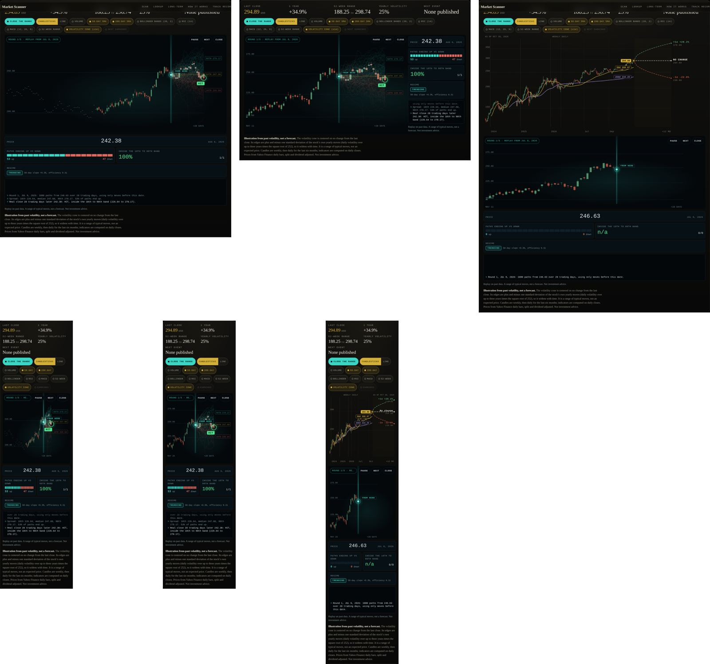
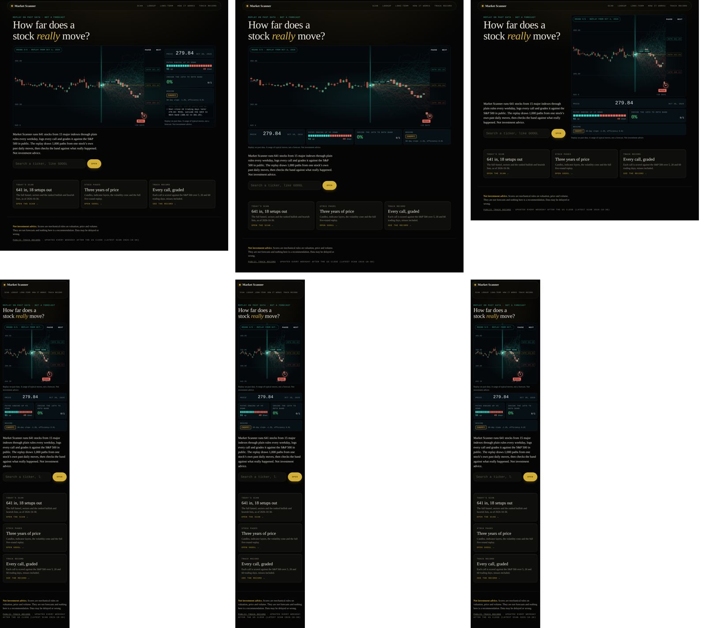
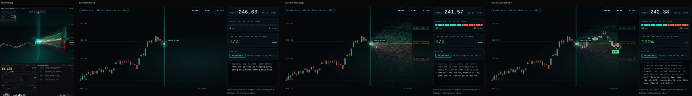

# Play the range: the replay animation and the new landing

Status: built on branch `claude/forecast-cone` (2026-11-01). Asked for by Ashton after four phone recordings of a "Kronos Forecast" candlestick animation: "Make the new trading tool visually do the same thing." He chose the Market Scanner stock pages, framed as an honest range, not a prediction. A follow-up made the replay the hero of a new landing page and asked for a simpler flow.

## 1. What it is

A replay that shows how wide a stock's moves typically are, and then checks that range against what really happened.

Each round:

1. A thin teal beam drops onto a past date and a glowing orb pulses at that day's close ("FROM HERE").
2. 1,000 paths fan out to the right over the next 20 trading days. Each path is built by drawing random days from the stock's own earlier daily log returns (a bootstrap), with the average move removed so the center is "no change". Paths that end above the start are teal, below are red. 200 are drawn on desktop and 80 on phones; all statistics use the full 1,000 so phones and desktops show the same numbers.
3. A gold line traces the median path, and tags at the right edge show the 10th, 50th and 90th percentile prices.
4. The real next 20 candles draw in on top. A green ring and HIT appear if the real close at the end fell inside the 10th to 90th band, a red ring and MISS if not.
5. The side panel ticks: price, the share of paths ending up versus down as a 20-segment bar, the running hit rate with its fraction, a regime chip (TRENDING or CHOPPY) and a short log of the beats in plain words.

On a stock page, "Play the range" runs five rounds back to back, then one "Today" beat that fans 12 months forward from the last close (the same horizon as the existing volatility cone) with no candles to land. On the landing page, one round plays on a featured stock when the hero is on screen, and Next plays the following round.

## 2. Honest framing (non-negotiable)

- It is a replay on past data. The label on the stage, the panel and the chart caption says: "Replay on past data. A range of typical moves, not a forecast. Not investment advice."
- Each round uses only returns that ended on or before its start date. The real candles are drawn after the fan, as the check.
- The returns are demeaned, so the fan has no built-in up or down tilt. The up versus down split shows the shape of the stock's past moves (skew), not a direction call.
- The hit rate is the real count across the five rounds, misses included. The landing shows the latest round, whatever its result (on 2026-10-30 data the featured stock, GOOGL, is a MISS).
- No buy, sell, target or predict language anywhere in the feature (a test checks the strings).
- Featured stock on the landing: the stock page with the largest market cap among USD listings. A size rule, not a pick.
- Ten rounds would say more than five; five rounds of 20 days on one stock is a demonstration of how a range behaves, not evidence that it works. The doc says so here; the UI says "replay" and shows the fraction, never a claim.

## 3. Data model

All math lives in `site/range.js` (pure, no DOM, loaded on demand). It runs in the browser and in Node, and `tests/test_range.py` checks it against an independent Python version on three real chart files.

| Item | Definition |
|---|---|
| Input | `dc`: the chart file's daily closes, oldest first (about three years) |
| Pool for a round starting on day k | `ln(dc[i] / dc[i-1])` for i = 1..k, minus their mean |
| Seed | FNV-1a 32-bit hash of `"<TICKER>|<round>"` (round 0 to 4, or `today`), fed to mulberry32. Same ticker, same paths, every time |
| Paths | 1,000; each step draws `floor(rand() * poolSize)` |
| Horizon | 20 trading days per replay round; 252 for the Today beat (the cone's 12 months) |
| Round dates | k = last - 20 - 15 * (4 - j) for j = 0..4: the last round's window ends on the latest close, earlier ones start 15 trading days apart (windows overlap by 5 days) |
| Percentiles | numpy's default (linear between closest ranks) on the 1,000 end values; median path = per-step median |
| HIT | real close at k + 20 is inside [10th, 90th] |
| Up share | paths whose end is above the start, rounded percent |
| Regime | slope = 50-day average at k divided by the 50-day average 20 days earlier, minus 1. Efficiency = net move over the last 20 days divided by the sum of absolute daily moves. TRENDING when the absolute slope is at least 3% and efficiency at least 0.30, else CHOPPY |

Real hit counts on the 2026-10-30 data: ABBV 4/5, AJG 4/5, 0700.HK 5/5. A 10th to 90th band should hold about 80% of outcomes, so 13 of 15 is in line with that, not a sign of skill.

## 4. Spec (WEB_DESIGN_REFERENCE section 6)

```
SITE: Market Scanner (static, site/)
ONE SIGNATURE MOMENT: the fan of paths opening from the orb, then the real candles landing in it with HIT or MISS
WEBSITE MAP:
  #/ landing: label, h1, replay stage + panel, one line, ticker search, 3 cards (Scan, Stock pages, Track record)
  #/scan: the previous home (funnel, sectors, index moves, what changed, lens tabs and lists), unchanged
  #/stock/<T>: unchanged, plus the Play the range pill in the layer row; the stage covers the plot while it runs
TYPE
  display: the site serif (h1 clamp 32 to 60 px on the landing)
  scale: mono 10 / 11 / 13 px, panel numbers 24 px (phones) and 28 px (760 px and up)
  tracking: mono labels .10 to .14em uppercase
  body: the site serif, 17 px landing line, 12 px stage notes
PALETTE (tokens on :root, style.css)
  --rg-bg #04080b / --rg-panel #071015 / --rg-line #10202a / --rg-ink #d8e6e6 / --rg-mute #7f9aa0
  --rg-teal #3ad6c4 (beam, orb, up paths, TRENDING) / --rg-red #e0675a (down paths, MISS)
  --rg-gold #d4af37 (median) / --rg-amber #e0a43a (CHOPPY) / --rg-hit #4fe08a (HIT ring)
  candles keep the chart's own up #5fa97c and down #cb5d46
SPACING
  8 px unit; stage padding 8; panel gap 8; side panel 276 px wide when the plot is 900 px or wider
RADII / BORDERS / SHADOWS
  stage 8 to 10 px radius, 1 px --rg-line borders, panel cells 6 px; glow from layered low-alpha strokes
  on canvas and a static box-shadow on the orb. No CSS blur filters, no backdrop-filter in the stage
MOTION
  easing: cubic-bezier(.2,.8,.2,1) (--rg-ease)
  durations: 160 ms (labels, presses), 600 ms (beam, ring, dim), 900 ms (fan draw)
  timeline per round (ms from start): beam 0 to 600 | orb scales in at 450 (320) and pulses 3 times
  (900 each, linear) | fan 900 to 1800, eased out, at most 6 ms of drawing per frame | median and tags 1800 |
  real candles 2100 to 3300 (one per 60 ms; the fan dims to 38%) | ring and verdict 3300 (600) | next round 4400
  Today beat: fan 900 to 1800, tags 1800, stop at 2600
  properties: transform and opacity only (Web Animations API); canvas drawing for paths and candles
  reduced-motion fallback: no animation at all; each round shows its final frame, a Next button steps on
SCROLL SYSTEM
  none. The loop stops when the stage leaves the screen (IntersectionObserver) or the tab is hidden, and resumes
MEDIA
  no images or video; the static fallback is the existing cone chart (default view) and the panel text
PERF TARGETS
  CLS 0.00; idle main thread under 20 ms/s after a run; Lighthouse 95+ (not run here, see section 8)
```

## 5. Layout alternatives

### Stock page (compared at 1280 and 390, mid round 1)



- A, overlay in place: the fan on the full-width daily window (100 days). The 20-day fan is a sliver, the panel sits below the chart, and the page grows when it opens.
- B, zoomed stage in place (picked): the stage covers the plot at the same height, zoomed to 40 days of history (30 on phones) plus the 20-day window. On desktop the panel sits inside the stage on the right, so nothing moves; on phones it stacks under the chart.
- C, separate block under the chart: keeps the 3-year chart visible but doubles the height, pushes the panel far down and adds layout on open.

B wins: the fan is readable on a phone, the desktop layout does not move at all, and the static cone is one tap away.

### Landing (compared at 1280 and 390, after round 5)



- A, full-width stage with the side panel and log (picked).
- B, full-width stage with the stats as one strip under it, log hidden.
- C, split: headline, line and search on the left, stage on the right.

On phones all three collapse to the same stack. A wins on desktop because the log console and the panel make it read as one instrument (closest to the reference), and the search still sits at the fold at 1280 x 900. C put the search higher but squeezed the stage to 700 px and lost the log. On phones the landing hides the price, regime and log cells (the stock page keeps them) so the search is reached sooner.

### Reference vs build



## 6. Accessibility and reduced motion

- Opt-in on stock pages: the static cone stays the default. The pill is a real button with `aria-pressed`; its label swaps between "Play the range" and "Hide the range" (same width, no shift).
- Stage controls are buttons in tab order right after the pill: Pause or Resume, Next (Replay again after the Today beat), Close.
- A visually hidden `role=status` live region announces each verdict, for example "Round 2 of 5: HIT. Real close 20 trading days later 256.57: HIT, inside the 10th to 90th band (232.59 to 278.81)."
- The canvases and decorative beam, orb and ring are `aria-hidden`; every number is in the panel as text.
- Reduced motion: no Web Animations, no frame loop, no Pause button. Each round renders its final frame (fan, median, tags, real candles, ring) and Next steps through.
- The landing autoplays one round only, and only while the stage is on screen and the tab is visible.

## 7. Done when (all checked on this branch)

- [x] `python -m pytest -q` passes (adds `tests/test_range.py`: JS vs Python for ABBV, AJG, 0700.HK; honest-copy and dash checks).
- [x] `node scripts/range_check.mjs <base>` passes at 390 x 844 with 4x CPU throttle and at 1280 x 900: no console errors, no horizontal overflow, CLS 0.00, panel fraction and every round's band and verdict match the Node recomputation for 3 tickers plus the landing's featured stock, idle main thread under 20 ms/s after the run, reduced motion shows final frames with Next, keyboard reaches the stage buttons.
- [x] Screenshots and a screen capture of a full run at 390 and 1280 (stock page and landing), plus a frame next to the reference.
- [x] No em or en dashes; `?v=` bumped on every changed asset.
- [ ] Lighthouse 95+ on the deployed preview (not run in this session: no Lighthouse binary here).

## 8. Current flow audit and a simpler information architecture

### What a first-time visitor saw at / (before this change)

1. Nav: Scan, Lookup, Long-term, How it works, Track record.
2. Hero: "Daily scan across 15 indexes", "641 stocks in. 18 setups out.", a 60-word paragraph.
3. A funnel dot-field animation with four stage counters, a caption, Next step and Skip animation buttons.
4. "Funnel by index" table (collapsed).
5. Sector block.
6. Index moves chip row.
7. "What changed" strip.
8. Three lens tabs (Mispricing, Short-term, Swing), a help note, then Bullish and Bearish ranked lists.
9. Footer disclaimer with another Track record link.

### What is confusing or redundant

- Eight blocks before the first ranked name, and two of them (the funnel animation and the funnel-by-index table) say the same thing.
- "Setups", "lenses" and three scoring scales (-100 to +100 for Mispricing, 0 to 100 for the others) arrive before the visitor knows what the site is.
- Lookup and Stock pages overlap: Lookup shows the same chart, then links to the stock page.
- Long-term (a separate SEC 10-K model) and How it works sit at the same nav level as the daily scan, so the nav reads as five equal products.
- Track record is linked in the nav and the footer; What changed is buried between the index chips and the tabs although it is the most "today" thing on the page.
- No single primary action: the hero offers Next step, Skip animation, a details toggle, tabs and every ticker link at once.

### Proposed structure

| Level | What | Status |
|---|---|---|
| Landing `#/` | Replay hero, one line, ticker search (primary action), three cards: Scan, Stock pages, Track record | Built in this pass |
| One click | Scan `#/scan`: What changed first, then the lens tabs and lists | Moved in this pass (unchanged inside) |
| One click | Stocks: one entry that merges Lookup and stock pages; search opens the stock page when one exists, else the lookup card | Landing search does this now; nav merge proposed |
| One click | Track record | Unchanged |
| Two clicks | Funnel animation, funnel by index, sectors, index moves: a collapsed "Market context" block at the bottom of Scan | Proposed (demote, not delete) |
| Two clicks | Long-term and How it works: under a "More" menu or footer links | Proposed |

Nothing was deleted in this pass. The old home is intact at `#/scan` and the nav's Scan link points there; the brand mark goes to the landing.

### Next steps (proposed, need Ashton's OK)

1. Nav to three items: Scan, Stocks, Track record, with Long-term and How it works under More.
2. On Scan, move What changed to the top and fold funnel, sectors and index moves into "Market context".
3. Lighthouse run on the Vercel preview, then merge.
